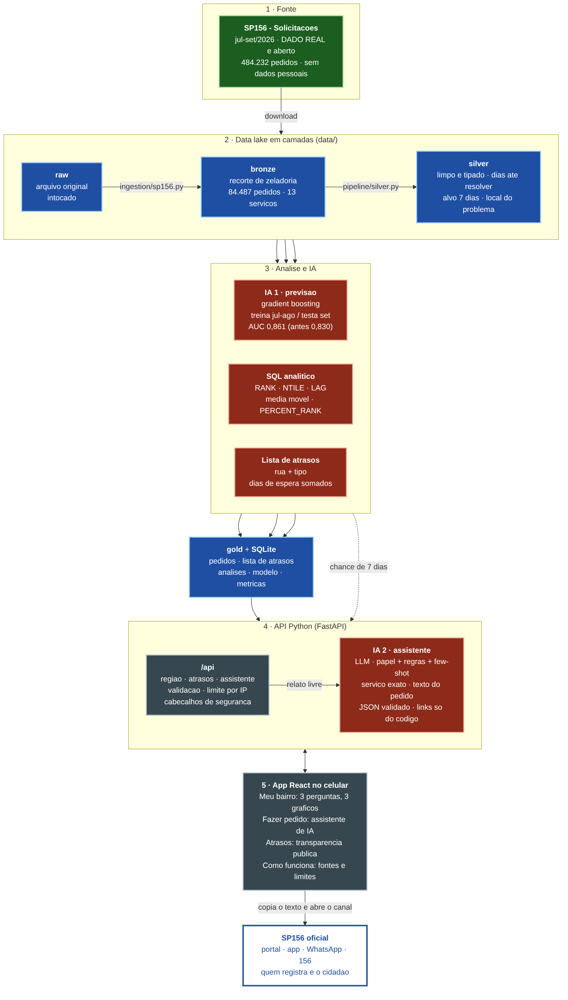

# Arquitetura

Fonte do diagrama: [`img/arquitetura.mmd`](img/arquitetura.mmd) (Mermaid). Para regerar:
`mmdc -i docs/img/arquitetura.mmd -o docs/img/arquitetura.png -b white -s 2`.

## 1. Fonte

**SP156 – Solicitações** (3º trimestre de 2026), dado real e aberto da Prefeitura de São Paulo, sem dados
pessoais. O arquivo (29 MB) é baixado do Portal de Dados Abertos e colocado em `data/raw/`; fica fora do Git.

## 2. Data lake em camadas

| Camada | Conteúdo | Gerada por |
|---|---|---|
| `raw` | Arquivo original, intocado | download |
| `bronze` | Recorte dos 13 serviços de zeladoria (84.487 de 484.232 pedidos) + relatório de ingestão | `ingestion/sp156.py` |
| `silver` | Tipos, validações, `dias_ate_resolver`, alvo `resolvido_7d`, `local_id`, `pedidos_no_local` | `pipeline/silver.py` |
| `gold` | Lista de atrasos, resultados das consultas analíticas, métricas das duas IAs | `transparencia/`, `analytics/`, `ml/`, `ia/` |

Tudo também vai para o **SQLite** (`data/citizentech.db`), que é o que a API consulta: `pedidos`,
`qualidade_dados`, `lista_atrasos` e `an_*`.

Por que camadas, se a fonte é um arquivo: o `raw` preserva a origem e permite reprocessar tudo; o `bronze`
evita reler um `.xlsx` de 35 s a cada execução; o `silver` concentra as regras de qualidade num lugar só, e
testado; o `gold` entrega à API só o que já está pronto. Acrescentar outro trimestre não muda nada depois
da ingestão.

## 3. Análise e IA

- **IA 1 – previsão** (`ml/modelo.py`): chance de um pedido ser resolvido em 7 dias. Treina com julho e agosto,
  é testada em setembro (corte temporal) e depois re-treinada com todo o período para uso na API
  (`data/modelo_7dias.pkl`).
- **SQL analítico** (`analytics/sql/`): quatro consultas com funções de janela, cada uma respondendo a uma
  pergunta de uma tela. A API as executa com os filtros do cidadão; `run_all.py` grava a versão da cidade
  inteira na gold como evidência.
- **Lista de atrasos** (`transparencia/atrasos.py`): pedidos abertos agrupados por rua e tipo de problema,
  ordenados pelos dias de espera somados, e comparados com o tempo típico daquele serviço na região.

## 4. API Python (FastAPI)

| Rota | O que entrega |
|---|---|
| `GET /api/regioes` | Subprefeituras, distritos e tipos de problema que existem nos dados |
| `GET /api/regiao?subprefeitura=&grupo=` | Número principal e as 3 perguntas, cada uma com resposta em uma frase e os dados do gráfico |
| `GET /api/atrasos?subprefeitura=&grupo=&limite=` | Lista de transparência |
| `POST /api/assistente` | IA 2: serviço exato, texto do pedido, o que falta, chance de 7 dias, contexto local e canais oficiais |
| `GET /api/canais`, `GET /api/sobre`, `GET /api/saude` | Canais oficiais, métricas das IAs, estado do serviço |

Documentação interativa em `http://localhost:8000/docs`. A mesma API serve o app compilado (`web/dist`) na
raiz, então um só endereço atende tudo.

As respostas em frase ("Piorou: 44% resolvidos em 7 dias nas últimas 3 semanas, contra 47% no fim de julho")
são geradas por **regras sobre os números**, não por IA: são determinísticas e conferíveis.

## 5. App React para celular

Vite + React, sem biblioteca de gráficos (SVG feito à mão, leve). Quatro telas, navegação por abas na parte de
baixo, pensado para telas de 360–430 px; instalável na tela inicial (manifest). Modo escuro automático.
Cada gráfico tem título em forma de pergunta, a resposta logo abaixo, legenda, valor ao toque e uma versão em
tabela (acessibilidade).

A identidade visual vem da rua: a região escolhida aparece numa **placa azul de rua de São Paulo** (que é também
o seletor), o azul da placa marca "sua região" nos gráficos, e o laranja de cone de obra aparece só onde há atraso.

## Fora do app: o SP156 oficial

O CitizenTech termina onde o SP156 começa: o cidadão copia o texto e abre o canal oficial (portal, aplicativo,
WhatsApp (11) 3230-5156 ou telefone 156). Os links ficam em `config.CANAIS`, com a página da Prefeitura de onde
cada um foi conferido.

## Decisões

| Decisão | Por quê |
|---|---|
| O app não recebe pedidos | Quem é responsável é a Prefeitura; duplicar o canal confundiria o cidadão e criaria dados pessoais para proteger |
| React + API, servidos juntos | Visual de app no celular, mas um só endereço e um só `docker compose up` para rodar |
| SQLite | Roda em qualquer máquina sem instalar banco; 85 mil linhas cabem com folga |
| Gradient boosting | Dados tabulares, poucos atributos, treino em segundos, resultado explicável |
| LLM opcional (`mock` por padrão) | O projeto roda sem chave; a IA generativa é demonstrável e medida, não obrigatória |
| Frases geradas por regra | Números conferíveis; nada de IA inventando conclusões sobre o bairro |
